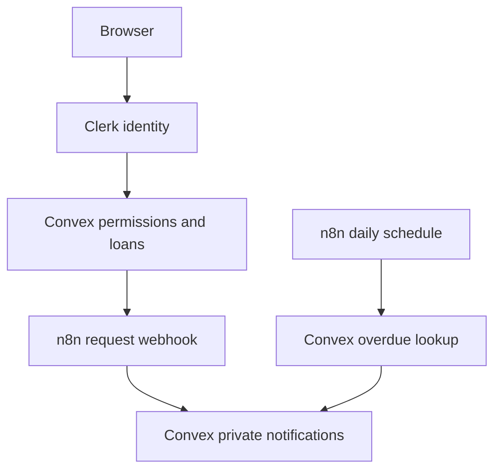

# LendLoop

**Borrow what you need. Lend what you don’t.**

A neighborhood lending board built for the Fluence take-home assignment using **Next.js App Router, TypeScript, Clerk, Convex, and self-hosted n8n**.

## Current verification status

- Next.js production build and strict TypeScript check pass without service credentials.
- Backend security and booking behavior are exercised with `convex-test`; signed envelopes and workflow Code nodes are tested locally.
- The public design preview runs without credentials and explicitly labels its sample listings. It does not provide fake authentication or bypass Convex.
- Live Clerk sessions, a deployed Convex backend, Docker/n8n import and execution, and the authenticated browser journey still require real service configuration. Do not represent the project as end-to-end verified until the manual checklist below passes.
- Notifications deliberately use the assignment’s permitted **logged mock** option: n8n triggers durable, private in-app notification records, rather than sending real email. A notification and its delivery status commit atomically in Convex.

## Quick start

Requirements: Node.js 22 or newer, npm, Docker Compose, and Clerk + Convex accounts.

```bash
npm ci
cp .env.example .env.local
npm run dev
```

Open `http://localhost:3000`. Without keys, you see the clearly labeled public design preview. Do not deploy that preview as your completed assignment.

### 1. Connect Clerk and Convex

1. Create a Clerk application with email authentication. Copy the publishable and secret keys into `.env.local`.
2. In Clerk, create a JWT template named **convex**, using the Convex template. Copy its issuer domain.
3. Run `npx convex dev`. Follow the interactive account/deployment setup. Keep it running while developing; it refreshes the checked-in bootstrap API types and watches Convex functions.
4. Set `NEXT_PUBLIC_CONVEX_URL` in `.env.local` to your deployment’s `.convex.cloud` URL.
5. In Convex deployment environment settings, set:
   - `CLERK_JWT_ISSUER_DOMAIN`: the Clerk issuer URL.
   - `ADMIN_SUBJECTS`: comma-separated Clerk user IDs for your administrators. These are **not emails or client-submitted roles**. Use a separate admin test account.
   - `AUTOMATION_SECRET`: at least 32 cryptographically random characters. Generate locally with `openssl rand -hex 32` (or a secure password generator).
   - `N8N_REQUEST_WEBHOOK_URL`: the active n8n production HTTPS URL, ending in `/webhook/lendloop-request`.
6. Restart Next.js after changing public environment variables, and let `npx convex dev` sync the authentication configuration.

All non-public queries and mutations independently check the Convex authenticated identity. Clerk UI visibility is not a security boundary. Without a configured issuer, authentication fails closed.

### 2. Start n8n

Docker Compose reads **`.env`**, not `.env.local`. Create an ignored `.env` containing only:

```dotenv
CONVEX_SITE_URL=https://YOUR-DEPLOYMENT.convex.site
AUTOMATION_SECRET=YOUR_RANDOM_SHARED_SECRET
N8N_ENCRYPTION_KEY=ANOTHER_LONG_RANDOM_SECRET
```

Use the same `AUTOMATION_SECRET` on Convex and n8n. Keep the encryption key stable across container restarts. The `.convex.site` URL is for HTTP actions; `.convex.cloud` is the React client URL.

```bash
docker compose up -d
```

Open `http://localhost:5678` and complete n8n owner setup. The editor binds only to loopback. For incoming Convex calls, provide a controlled HTTPS endpoint/reverse proxy for the production **webhook path**, keeping the editor private. A cloud Convex deployment cannot reach your laptop’s localhost. Set n8n’s `WEBHOOK_URL` to the external HTTPS origin when using a reverse proxy, and configure the proxy according to n8n’s documentation.

The pinned n8n image uses the built-in task runner. Code nodes require the `crypto` module and environment access; Compose explicitly permits these. Only trusted operators should edit workflows. This project chooses self-hosted n8n; n8n Cloud environment/credential handling needs adaptation.

### 3. Import the workflows

Import the three JSON files from `n8n/workflows/` using n8n’s **Import from file**:

1. `error-handler.json`
2. `request-notification.json`
3. `overdue-reminders.json`

For each of the two main workflows, open Settings and explicitly select **LendLoop · Visible automation errors** as its error workflow. Imported IDs can change between instances; do not rely on the exported ID alone. Publish/activate both main workflows (wording depends on n8n version). Error Trigger runs on production failures, not ordinary manual test executions.

Use the production webhook URL, not `/webhook-test/`. The webhook acknowledges only after the signed Convex callback commits. HTTP nodes retry three times. Convex also retries request delivery with exponential backoff, up to five failed attempts; exhausted events appear in Admin and can be retried.

The overdue workflow runs at **09:00 UTC daily**. It fetches opaque business identifiers inside signed envelopes, then calls a signed completion endpoint for each reminder. A manual run is useful for review. Empty batches stop naturally. Errors remain visible in n8n executions and the error workflow writes only sanitized metadata to the container logs.

Successful execution payloads are not retained; failed executions are retained for seven days. Envelopes contain opaque event/reminder IDs and signatures, not names, email addresses, tool descriptions, or authentication tokens.

## Available experiences

- **Anonymous:** live Convex list of currently available tools, exposing exactly name/category, plus Clerk modal sign-in.
- **Member:** category filtering, availability, listing creation/editing/removal, borrow date requests, incoming requests, approval/decline, lender-confirmed return, pending-request cancellation, notifications, and recent reminder time on loans.
- **Admin:** all loans, any-listing removal, trusted-lender controls, delivery activity, and failed-event retry. Archiving a listing retains loan history and cancels pending requests with notifications. Active loans remain returnable.

## Architecture



See `docs/architecture.md` for decisions and `docs/production.md` for production changes.

## Validation

```bash
npm run typecheck
npm test
npm run build
```

`convex-test` exercises the actual Convex functions against the real schema with independent identities. Tests cover anonymous field projection, unauthorized access, booking races, invalid transitions, archival, delivery deduplication, overdue reminder deduplication, signature expiry/tampering, and the signed HTTP boundary. Workflow tests execute the exported JavaScript signing/verification nodes with n8n-shaped inputs. They do **not** replace importing and running the workflows in n8n.

CI runs the same checks on push and pull request. No credentials are required for the local automated suite.

### Manual acceptance checklist (required before submission)

- [ ] Deploy Convex with the Clerk issuer, admin subjects, and automation settings.
- [ ] Sign in as member A and list a tool. Sign out: the public response exposes only its name/category.
- [ ] Sign in as member B; request dates. Confirm B cannot edit A’s listing or approve the request through direct Convex calls.
- [ ] A approves; B sees the update and receives the n8n-triggered mock notification. A confirms return.
- [ ] Sign in as admin; mark A trusted and verify B sees the badge. Remove a listing and verify history is retained.
- [ ] In a disposable development deployment only, create an overdue approved loan using Convex’s Data dashboard. Run the daily workflow twice: one notification for that loan/day, with reminder activity in the app.
- [ ] Send a tampered signed envelope: no notification is committed.
- [ ] Stop n8n, create a request, and inspect retries. Restore it and verify eventual delivery, or use Admin Retry after exhaustion.
- [ ] Confirm the error workflow is linked and visible after a production workflow failure.
- [ ] Test keyboard navigation, modal focus/escape, and a narrow phone viewport with real sessions.
- [ ] Run checks again and record a short demonstration.

## Submission

Push the source, lockfile, workflow JSON exports, Compose configuration, and docs to your own GitHub repository. Never push `.env`, `.env.local`, generated credentials, n8n volumes, or bank data. Deploy Next.js on a compatible Node.js host (for example Vercel) with Clerk keys and Convex URL; deploy Convex separately and keep n8n reachable over HTTPS. Set `NEXT_PUBLIC_*` values before the production build because Next.js embeds them into client bundles.

The repository is intentionally standard Next.js rather than a substitute framework/runtime. A repository archive is provided for import into your GitHub account; no GitHub repository or live service accounts are created automatically.

Use `docs/reviewer-guide.md` for the technical walkthrough.
