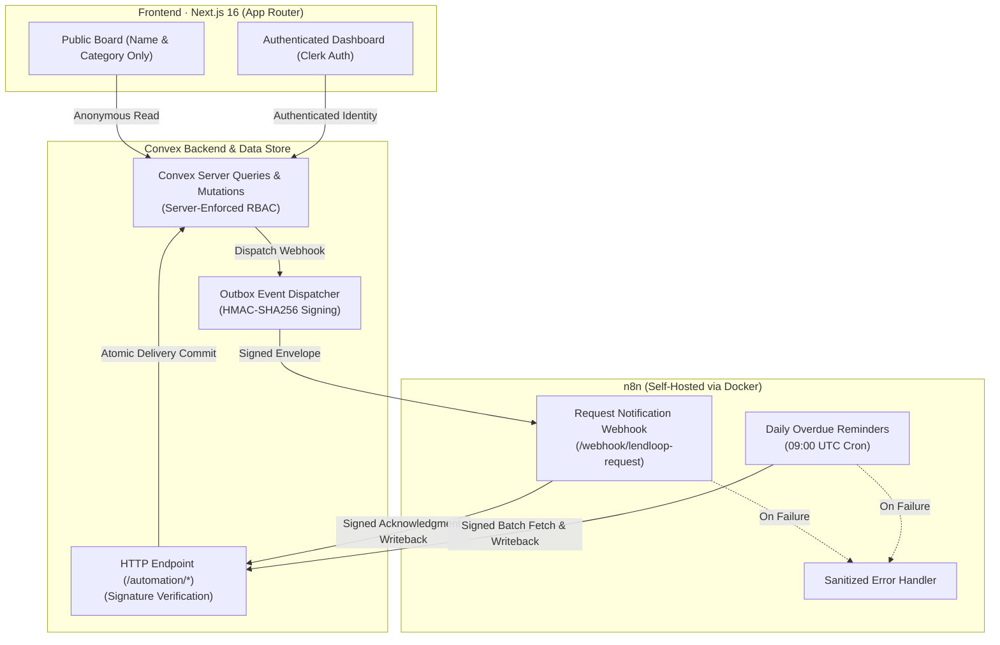

# LendLoop

> **Borrow what you need. Lend what you don’t.**

A neighborhood tool-lending co-op platform built for the Fluence take-home assignment using **Next.js App Router, TypeScript, Clerk, Convex, and self-hosted n8n**.

---

## Architecture Overview



---

## Quick Start (Local Setup)

### Prerequisites
- **Node.js**: `22.x` or newer and `npm`
- **Docker & Docker Compose**: For self-hosted n8n
- **Clerk & Convex accounts**: For live authentication and real-time backend

### 1. Install & Launch Preview
```bash
git clone https://github.com/Anduamlakalehegne/lendloop.git
cd lendloop
npm ci
cp .env.example .env.local
npm run dev
```
Open [http://localhost:3000](http://localhost:3000). When launched without environment credentials, the application runs in a standalone preview mode with curated sample tools. Full lending workflows and authentication activate once Clerk and Convex credentials are provided.

---

### 2. Configure Clerk & Convex

1. **Clerk Setup**:
   - Create a Clerk application with email authentication.
   - Copy `NEXT_PUBLIC_CLERK_PUBLISHABLE_KEY` and `CLERK_SECRET_KEY` into `.env.local`.
   - In Clerk, create a JWT Template named **`convex`** (using the Convex template). Copy the **Issuer URL**.
2. **Convex Setup**:
   - Run `npx convex dev` to initialize your local or cloud deployment.
   - Set `NEXT_PUBLIC_CONVEX_URL` in `.env.local` to your deployment's client URL (`.convex.cloud` or `http://127.0.0.1:3210`).
   - In Convex deployment environment settings (`npx convex env set` or via Convex dashboard):
     ```bash
     npx convex env set CLERK_JWT_ISSUER_DOMAIN "https://your-clerk-issuer.clerk.accounts.dev"
     npx convex env set ADMIN_SUBJECTS "user_clerk_id_1,user_clerk_id_2"
     npx convex env set AUTOMATION_SECRET "your_random_secret_at_least_32_characters_long"
     npx convex env set N8N_REQUEST_WEBHOOK_URL "http://localhost:5678/webhook/lendloop-request"
     ```
   *(Note: `AUTOMATION_SECRET` must be at least 32 characters to prevent brute-force forgery. Use `openssl rand -hex 32` to generate one).*

---

### 3. Start n8n (Docker)

Docker Compose reads **`.env`** (not `.env.local`). Create an ignored `.env` in the repository root:

```dotenv
CONVEX_SITE_URL=http://host.docker.internal:3211
AUTOMATION_SECRET=your_random_secret_at_least_32_characters_long
N8N_ENCRYPTION_KEY=another_long_random_stable_encryption_key
```

*Notes:*
- `CONVEX_SITE_URL`: Use `http://host.docker.internal:3211` for local Convex dev accessed from inside the Docker container, or `https://<deployment>.convex.site` for hosted Convex.
- `AUTOMATION_SECRET`: Must match the exact value configured in Convex.
- `N8N_ENCRYPTION_KEY`: Keep stable across container restarts to preserve workflow encryption.

Launch the container:
```bash
docker compose up -d
```
Open [http://localhost:5678](http://localhost:5678) and complete initial owner onboarding.

---

### 4. Import n8n Workflows

In n8n, choose **Import from File** (or workflows directory) for each file in `n8n/workflows/`:
1. `error-handler.json` (**LendLoop · Visible automation errors**)
2. `request-notification.json` (**LendLoop · Request notifications**)
3. `overdue-reminders.json` (**LendLoop · Daily overdue reminders**)

In both main workflows, set **Error Workflow** to `LendLoop · Visible automation errors` in Workflow Settings, and toggle them to **Active / Published**.

---

## Security & Data-Minimization Decisions

1. **Strict Data Minimization on Public Pages:**
   - The public `/` endpoint queries `api.tools.publicList`, which projects **strictly `name` and `category`** (`map(t => ({ name: t.name, category: t.category }))`).
   - Owner IDs, borrower names, contact details, and dates are completely excluded from public payloads to prevent scraping and protect neighbor privacy.
2. **Server-Side RBAC Enforcement in Convex:**
   - Role checks are **never** trusted from client parameters or UI state.
   - All mutations and queries verify identity via `ctx.auth.getUserIdentity()`.
   - Admin privileges are verified against a server-controlled `ADMIN_SUBJECTS` list.
   - Members can only modify or delete their own tools and loans.
   - Listing removal: Ordinary members are blocked if unresolved borrow requests or active loans exist on the tool. Only administrators can force-archive listings with active loans while safely preserving historical returns.
3. **Signed HMAC-SHA256 Automation Envelopes:**
   - Outgoing and incoming automation payloads are signed with HMAC-SHA256 over timestamped JSON (`timestamp.payload`).
   - Replay protection: Signatures expire after 5 minutes (`300,000 ms`).
   - Secrets are cryptographically enforced to be &ge; 32 characters in `lib/signatures.ts`.
   - Webhook payloads contain opaque identifiers only (e.g. `eventId`, `loanId`). Personal borrower details, emails, and tokens are never broadcast to the automation runner.
4. **Tightened Webhook Destination Validation:**
   - [`convex/delivery.ts`](convex/delivery.ts) uses `new URL()` validation.
   - Remote production destinations strictly require `https:`. Plain `http:` is permitted only on exact loopback hostnames (`localhost` or `127.0.0.1`), eliminating substring/domain spoofing risks.
5. **Idempotent Delivery & Retry Engine:**
   - Webhook dispatches use an outbox pattern in Convex with exponential backoff (up to 5 retries).
   - Exhausted attempts are captured and flagged as `failed` with visible error details and manual "Deliver now" / "Retry" controls in the Admin panel, preventing silent failures.
   - Daily overdue reminders deduplicate writebacks per loan per day (`key: ${loanId}:${day}`).

---

## Testing & Quality Assurance

Run the test suite and typechecks locally without needing live credentials:

```bash
# Typecheck
npm run typecheck

# Automated Vitest Suite (29 tests)
npm test

# Production Build (Verifies credential-free prerendering)
npm run build
```

### Coverage Summary (29 Tests across 2 Suites)
- **`tests/security.test.ts` (26 tests)**:
  - Anonymous projection and field minimization.
  - Server-side RBAC: member isolation, unauthorized edit/delete rejection, admin moderation rights.
  - Concurrent loan approval serialization and overlapping booking race prevention.
  - Member vs Admin listing removal permissions with active loans.
  - Tampered, expired, and invalid HMAC signature rejection.
  - Webhook URL destination parsing, remote HTTPS enforcement, and loopback spoofing rejection.
- **`tests/workflows.test.ts` (3 tests)**:
  - Verification that exported n8n workflow JSON files contain zero embedded secrets.
  - Execution of n8n Code nodes (HMAC verification, writeback signing) with synthetic payloads.
  - Overdue reminder batch expansion contract testing.

### CI Pipeline
CI is automated via GitHub Actions in [`.github/workflows/checks.yml`](.github/workflows/checks.yml) on push and pull request. It executes `npm ci`, `npm run typecheck`, `npm test`, and `npm run build` cleanly without third-party secrets. *(Note: When inspecting a downloaded ZIP archive, ensure hidden dot-directories such as `.github/` are preserved by your extraction tool).*

---

## Role-Based Access for Evaluators

1. **Member View:**
   Sign in with any Clerk account. You can list tools, request borrow dates on neighborhood listings, approve/decline incoming requests, confirm returns, and see relative automation activity (e.g., `🕒 Approval notification sent just now`).
2. **Admin View:**
   To elevate an account to Administrator, obtain your Clerk User ID (displayed on the dashboard role pill) and run:
   ```bash
   npx convex env set ADMIN_SUBJECTS "user_YOUR_CLERK_ID"
   ```
   Refresh the page. The **Admin** tab immediately unlocks, allowing you to:
   - Mark/unmark neighbors as **Trusted Lender**.
   - Moderate and remove any neighborhood listing.
   - Audit all loans across the entire community.
   - Inspect webhook delivery logs and trigger manual retries.

---

## What I Would Change for Production

1. **Transactional Email Transport:**
   The assignment permits logged mock notifications. In production, n8n would integrate with a transactional email provider (such as Resend or Postmark) using provider-level idempotency keys (`Idempotency-Key: event_${id}`) to guarantee that network retries never send duplicate emails to neighbors.
2. **Reverse Proxy & Domain Isolation:**
   Host n8n behind an HTTPS reverse proxy (e.g. Caddy, Cloudflare, or AWS ALB) with mutual TLS or IP allowlisting between Convex and n8n. Keep the n8n management UI completely private on a corporate VPN while exposing only `/webhook/*` publicly.
3. **Pagination & Compound Indexing:**
   Paginate public and authenticated tool queries using Convex cursor-based pagination (`.paginate()`) to handle thousands of neighborhood tools efficiently.
4. **Key Rotation & Secrets Management:**
   Use AWS Secrets Manager, Doppler, or HashiCorp Vault to rotate the `AUTOMATION_SECRET` and Clerk keys with dual-secret grace periods during rotation.
5. **Auditing & Telemetry:**
   Add a dedicated immutable `audit_logs` table in Convex recording all administrative moderation events, trust status changes, and listing deletions for compliance and safety.
